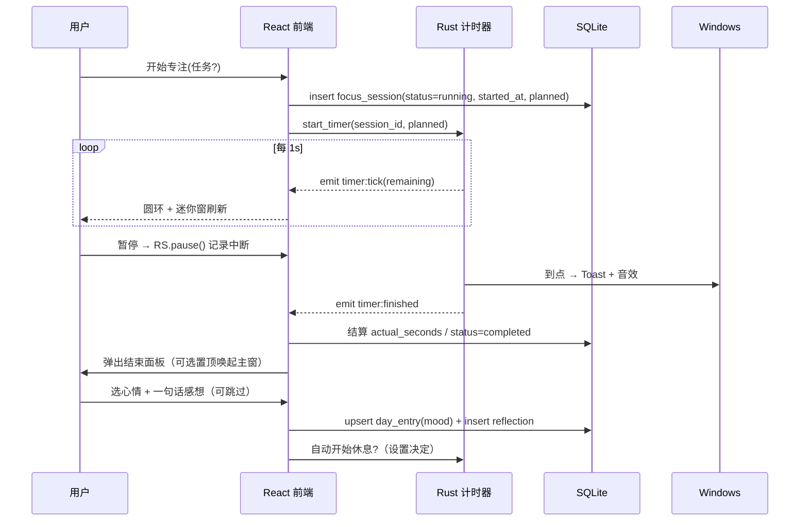
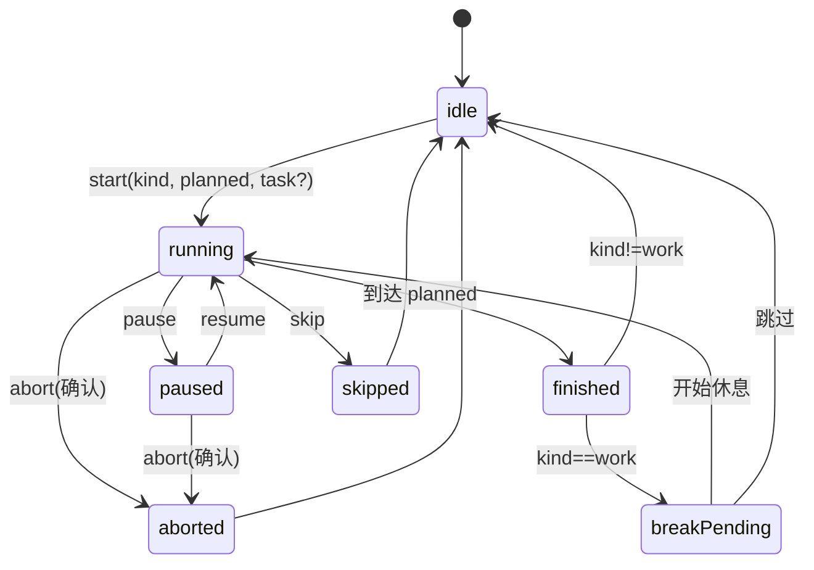

# 「番茄 · 日历 · 心情 · 日记」Windows 桌面应用 —— 产品与技术设计文档

| 项目 | 内容 |
| --- | --- |
| 文档版本 | **v0.2**（草案，已按你的三条决定修订） |
| 日期 | 2026-11-16 |
| 状态 | **仅设计，不写代码**。本版用于确认产品范围与技术路线 |
| 平台 | **Windows 10/11 x64 单平台**（不做移动端、不做 Web、不做 macOS） |
| 数据 | **纯本地**（SQLite，无账号无网络），云同步延后 |
| 日记形态 | **Markdown 纯文本 + 预览**，富文本延后 |
| 一句话定位 | 以番茄钟为入口，把「今天专注了什么、心情如何、想了什么」沉淀成一条可回看的日历时间线 |

### 版本变更（v0.1 → v0.2）

| 变更 | 内容 |
| --- | --- |
| 平台收窄 | 移除 Android/iOS/Web 全部内容；平台差异章改为 Windows 专项 |
| 技术栈切换 | Flutter → **Tauri 2 + React + TypeScript**（Windows 单端更合适，见 §9.1 与附录 A） |
| 导航形态 | 移动底部导航 → **桌面左侧栏 + 托盘 + 迷你窗** |
| 计时保活 | 前台服务 → **Rust 侧常驻计时 + Windows Toast** |
| 里程碑 | 按 Windows 单端重排，去掉移动端专项（约 3 周） |
| 待确认 | Q1~Q3 已定案，剩余 5 条改为 Windows 相关 |

---

## 0. 阅读指引

- 本文件是**决策用文档**：先给结论（§3、§4、§9），再给细节（数据模型、交互规则、里程碑）。
- 所有"参考开源"处标注 **复用等级**：`A 直接用`（依赖/直接集成）、`B 借鉴交互`（抄设计不抄代码）、`C 仅参考数据模型`。
- §14 是剩余待确认项，均带默认建议；不回复即按默认推进。

---

## 1. 背景与目标

### 1.1 要解决的问题

市面上的番茄钟只解决"专注 25 分钟"，日记 App 只解决"写"，两者之间是断的：

- 专注结束后，用户没有低成本的地方记下"刚刚在做什么、感觉怎么样"；
- 心情/日记数据与"当天投入了多少"没有关联，月度回看时只有文字没有量；
- 数据在别人的服务器上，导出困难。

### 1.2 产品目标（可验证）

| 编号 | 目标 | 衡量方式 |
| --- | --- | --- |
| G1 | 一次专注的完整闭环 ≤ 3 次点击 | 从"开始"到"写下感想并保存"的操作计数 |
| G2 | 日历一屏看出"哪天专注多、心情好" | 月视图无需点击即可见热力 + 心情点 |
| G3 | 断网 100% 可用 | 禁用网卡后全功能可用 |
| G4 | 数据可带走 | 一键导出 Markdown + JSON，可反向导入 |
| G5 | 不重复造轮子 | 自研只覆盖业务规则；UI/日历/图表/存储/通知全部用成熟库 |

### 1.3 非目标（本阶段明确不做）

账号体系、云同步、多人协作、社交打卡、移动端、macOS/Linux 发行、Web 版、AI 总结、系统日历双向同步（CalDAV）。→ 均进入 §4.3「占位」。

---

## 2. 目标用户与场景

**主用户画像**：学生 / 自由职业者 / 需要自我管理的知识工作者，**主要在 Windows 电脑前工作**，愿意每天花 1~3 分钟记录，重视隐私与数据主权。

| 场景 | 描述 | 涉及模块 |
| --- | --- | --- |
| S1 开始一天 | 早上打开（或托盘唤起），看到"今天"：昨日回顾 + 今日待办 + 开始番茄 | 今天页 / 日历 |
| S2 专注中 | 全屏或迷你置顶窗倒计时；可切到别的窗口继续工作 | 番茄钟 / 迷你窗 |
| S3 专注后 | Toast 提示 + 自动弹出 15 秒轻量面板：这次做了什么 + 心情 + 一句话感想（可跳过） | 番茄钟 → 日记 |
| S4 晚上写日记 | 日历点今天 → 写正文、选心情、打标签 | 日记 |
| S5 周末回看 | 周/月视图 + 统计：专注时长、完成数、心情曲线、连续天数 | 日历 / 统计 |
| S6 补记 | 忘了写，点日历上过去某天补写（不补记番茄） | 日记 |
| S7 挂着干活 | 关窗口不退出（缩托盘），快捷键 Ctrl+Alt+P 随时开始/暂停 | 托盘 / 全局快捷键 |

---

## 3. 核心决策（先看这里）

| 决策点 | 结论 | 理由 |
| --- | --- | --- |
| 平台 | **Windows 10/11 x64**，安装包 NSIS；可选 arm64 后补 | 你的决定 |
| 技术栈 | **Tauri 2 + React 19 + TypeScript + Vite + Tailwind + shadcn/ui** | 包体小（<20MB）、内存低、Rust 侧计时稳、前端生态最厚 |
| 窗口形态 | 主窗口 + **迷你置顶窗** + 托盘常驻 + 全局快捷键 | 番茄钟的核心场景是"一边干别的活一边看时间" |
| 数据 | 本地 SQLite（`%APPDATA%\<app>\data.db`），无网络权限 | 隐私 + 零运维 |
| 计时权威 | **Rust 侧单例计时器 + 时间戳**，前端只做渲染 | 窗口最小化/隐藏时 WebView 定时器会被节流，必须在 Rust 跑 |
| 日历 | `react-day-picker` + 自绘格子着色（热力/心情点/日记角标） | 不自己实现日期网格与键盘导航 |
| 图表 | `Recharts` | 折线/柱状/环图够用，体积比 ECharts 小 |
| 编辑器 | **textarea + `react-markdown` 预览**，不做富文本 | 你的决定；升级路径见 §9.6 |
| 心情模型 | 5 级 emoji + 可选标签（能量值留字段） | 3 秒可完成，长期有数据 |
| 同步 | v1 不做，仅手动导出/导入 | 字段先埋 `updated_at/deleted_at`，为 v2 留路 |

---

## 4. 功能范围（MoSCoW）

### 4.1 P0 —— 第一版必须做

#### F1 番茄钟（核心）

| 项 | 规则 |
| --- | --- |
| 阶段 | 专注 / 短休 / 长休，默认 25 / 5 / 15 分钟，长休间隔 4 个番茄 |
| 操作 | 开始、暂停、继续、跳过（skip）、放弃（abort，二次确认）、+5 分钟 |
| 计时实现 | Rust 侧 `tokio::interval`（1s）→ emit `timer:tick` 给前端；前端不持有权威时间 |
| 自动流转 | 开关项：专注结束自动开始休息 / 休息结束自动开始专注（**默认关**） |
| 绑定任务 | 可选绑定一个待办（轻量任务清单，见 F5），不强制 |
| 结束反馈 | Windows Toast + 音效（可换/可静音）+ 主窗口置顶唤起（可关） |
| 中断记录 | 记录暂停次数与累计暂停时长；abort 也入库（`status=aborted`），不计入完成数 |
| 跨零点 | 以 `started_at` 的**本地日期**归属；冗余 `local_date` 便于统计 |
| 恢复 | 冷启动/休眠唤醒后按 `now - started_at` 重算；已过期则结算为 completed |
| 界面 | 主窗口大圆环；迷你窗（320×120，置顶、可拖动、记住位置） |
| 专注保护 | 可选「专注期间置顶迷你窗 + 隐藏其他通知」（P1） |

#### F2 日历

- 月视图（默认）+ 周视图；左右翻页，Today 按钮回正。
- 每格显示：**专注时长热力底色**（0 / <30m / 30–90m / >90m 四档）+ **心情小点**（5 色）+ **日记角标**。
- 顶部月度摘要：本月专注小时、完成番茄数、记录天数、平均心情。
- 点击某天 → 「当日详情页」（时间线：番茄记录 + 心情 + 日记 + 感想）。
- 年视图（GitHub 风格热力图）放 P1。

#### F3 心情

- 每天一条 `day_entry`，心情 1~5（很糟/低落/一般/不错/很好）+ emoji + 颜色。
- 可选标签（多选：学习/工作/运动/社交/睡眠/情绪…，内置 + 自定义）。
- 一天内多次记录 → 取最新为当日主心情，历史保留在时间线（P1）。
- 趋势：7 日折线 + 月度分布（P1，Recharts）。

#### F4 日记 / 感想

- 日记：按日期一篇，Markdown 正文 + 可选标题；`#标签` 自动提取；全文搜索（P1 用 SQLite FTS5）。
- 感想（reflection）两种触发：
  1. **专注后轻量感想**：结束面板一句话（≤280 字），可跳过；
  2. **每日复盘**：日记页底部三问（今天最有价值的一件事 / 卡在哪 / 明天第一步），模板可改。
- 模板：内置 3 套（极简一句话 / 三问复盘 / 自由书写）。
- 编辑态：左编辑右预览（宽屏）/ 上编辑下预览（窄窗）；自动保存（停止输入 800ms + 切走窗口立即保存）。
- 快捷键：`Ctrl+S` 手动保存、`Ctrl+B` 粗体插入、`Ctrl+Enter` 完成今日记录。

#### F5 轻量任务清单（为番茄服务，不做完整 Todo）

- 字段：标题、备注、状态（待办/完成/归档）、预估番茄数、实际番茄数。
- 视图：今日列表 + 收件箱。不做项目/看板/子任务（占位）。

#### F6 设置与数据

- 时长、自动流转、音效与音量、Toast 开关、窗口行为（关闭=最小化到托盘/退出）、开机自启、全局快捷键、主题（浅/深/跟随）、周起始日、语言（中/英）。
- 导出：Markdown 打包（每天一个 .md）+ JSON 全量；导入 JSON（合并/覆盖两种策略）。
- 数据目录显示与"打开所在文件夹"、清空数据（二次确认）、DB 迁移（升级前自动备份）。

### 4.2 P1 —— 第二版

- 统计页：周/月/年报表（专注时长、番茄数、按任务/标签分布、心情-专注相关性）。
- 连续记录天数（streak）、年度热力图。
- 全文搜索（FTS5）、标签管理、日记模板自定义。
- 托盘菜单完善（开始/暂停/跳过/打开今天）、迷你窗透明度、专注期免打扰（Windows 通知抑制）。
- 自动更新（`tauri-plugin-updater`）。

### 4.3 P2 —— 占位（本版只留入口与空状态，不实现）

| 占位功能 | 占位方式 | 未来实现要点 |
| --- | --- | --- |
| 云同步 | 设置页灰置「同步（即将上线）」 | v2：自建后端 + `updated_at` 增量同步（§9.5） |
| 习惯打卡 | 侧栏预留入口，页面显示"规划中" | 复用 uhabits 的热力与 streak 思路 |
| 白噪音/专注音乐 | 番茄页音量图标 → 提示 v2 | 本地音频文件，避免版权风险 |
| AI 周报 | 统计页按钮占位 | 本地/自建模型，明确"数据不出设备"开关 |
| 皮肤/主题包 | 设置项占位 | 只做配色，不做皮肤市场 |
| CalDAV / 系统日历 | 设置项占位 | 参考 Obsidian Pomodoro Calendar 插件的双向同步思路 |
| 多显示器专注模式 | 不出现 | 后续按需 |

---

## 5. 信息架构与页面

### 5.1 导航结构（桌面）

```
左侧栏（可折叠）
├── 今天 Today          ← 默认页
├── 日历 Calendar
├── 统计 Stats          (P1，先占位)
└── 设置 Settings

窗口 / 系统层
├── 主窗口（1440×900 默认，最小 960×640，记住位置尺寸）
├── 迷你窗（置顶、无边框、可拖动、Esc 关闭）
├── 托盘图标 + 右键菜单（开始/暂停/跳过 / 打开今天 / 显示迷你窗 / 退出）
└── 全局快捷键 Ctrl+Alt+P（开始/暂停）、Ctrl+Alt+O（打开主窗）
```

### 5.2 页面清单

| # | 页面 | 关键模块 | 空状态方向 |
| --- | --- | --- | --- |
| P-01 | 今天 | 日期问候、今日摘要环（专注/番茄/心情）、任务列表、开始专注按钮、今日日记入口 | 「今天还没开始，来一个 25 分钟？」 |
| P-02 | 专注中（主窗全屏态） | 圆环进度、剩余时间、任务名、暂停/放弃/跳过、切迷你窗 | — |
| P-03 | 番茄结束面板 | 完成反馈、本次任务确认、心情选择、一句话感想、保存/跳过 | — |
| P-04 | 日历（月/周） | 月摘要、日期格（热力+心情点+日记角标）、图例、键盘方向键导航 | 「这个月还没有记录」 |
| P-05 | 当日详情 | 时间线（番茄/心情/日记/感想）、编辑入口、当日统计 | 「这天是空的，可以补写日记」 |
| P-06 | 日记编辑 | 标题、Markdown 编辑+预览、心情、标签、模板、自动保存状态 | 「写点什么，哪怕一句」 |
| P-07 | 任务清单 | 今日/收件箱、完成勾选、预估番茄 | 「先加一件今天要做的事」 |
| P-08 | 统计（P1） | 时长趋势、心情曲线、标签分布、streak | 「再记录几天就能看到趋势」 |
| P-09 | 设置 | 计时/通知/窗口/快捷键/外观/数据/关于 | — |

### 5.3 关键界面草图（文字线框）

**P-01 今天（宽屏）**

```
┌──────────┬────────────────────────────────────────────────┐
│  番茄日历 │  11月16日 周日                       ☾  —  ✕   │
│          │  今天专注 1h 15m · 3 个番茄                     │
│ ▸ 今天    │  ┌──────────────────────┬───────────────────┐  │
│   日历    │  │      ╭─────────╮     │ 今日心情          │  │
│   统计    │  │      │  25:00  │     │ 😞 😐 🙂 😊 🤩    │  │
│          │  │      │ 开始专注 │     │                   │  │
│  ──────  │  │      ╰─────────╯     │ 今日日记          │  │
│  + 新建   │  │  任务：写设计文档 ▾   │ 还没写，去写 →    │  │
│          │  └──────────────────────┴───────────────────┘  │
│          │  任务                                   + 添加  │
│          │  ☐ 写设计文档                2/4 番茄           │
│          │  ☑ 晨间阅读                  1/1               │
└──────────┴────────────────────────────────────────────────┘
```

**P-04 日历（月）**

```
  2026 年 11 月              ‹  ›   今天        本月 12h 40m · 31 个番茄
 一   二   三   四   五   六   日
                    1    2
  3    4    5    6    7    8    9
 ▓    ░    ▓▓   ·    ▓    ░    ·        ← 底色=专注热力，点=心情，·=有日记
 🙂   😞   😊        😐   🙂
 10   11   12   13   14   15   16
 ▓▓   ▓▓▓  ·    ▓    ▓▓   ·    ▓
 🙂   🤩        🙂   😊        🙂
 图例：专注 ░<30m ▓30–90m ▓▓>90m    心情 ●●●●●
```

**迷你窗（320×120，置顶）**

```
┌───────────────────────────────┐
│ ⏸  18:42   写设计文档      ✕  │
│ ████████████░░░░░░░░  74%     │
└───────────────────────────────┘
```

---

## 6. 核心流程

### 6.1 一次完整专注（主流程）



### 6.2 冷启动与休眠恢复

1. 启动时查询最后一条 `status=running` 的 session；
2. `remaining = planned - (now - started_at - paused_total_ms)`；
3. `remaining > 0` → 恢复运行态并重启 Rust 计时；
4. `remaining <= 0` → 结算 completed 并提示补记感想；
5. `now - started_at > planned * 3` → 视为异常（关机很久），结算为 `completed_estimated`，提示"已自动结算，可修正"；
6. 监听系统休眠/唤醒（`WM_POWERBROADCAST` / Tauri 窗口事件），唤醒后**强制重算一次**，不信任 tick 计数。

### 6.3 补记

- 允许对**过去 30 天**补写日记/心情；不允许补记番茄（保持数据真实）。
- 补记在 `day_entry` 标记 `is_backfilled=true`，统计可区分。

---

## 7. 数据模型

### 7.1 实体关系

```
task 1 ── n focus_session
day_entry 1 ── n reflection（按 local_date 关联，弱外键）
tag n ── n day_entry / reflection（v1 用 JSON 存 id 列表）
stat_daily 为物化缓存（可由其他表重算）
```

### 7.2 表结构（SQLite，`tauri-plugin-sql` + sqlx）

**task**

| 字段 | 类型 | 说明 |
| --- | --- | --- |
| id | TEXT PK | uuid |
| title | TEXT | ≤200 |
| note | TEXT? | |
| status | TEXT | todo / done / archived |
| est_pomodoros | INT | 预估 |
| sort_order | REAL | 拖拽排序 |
| created_at / updated_at | INT (epoch ms) | |

**focus_session**

| 字段 | 类型 | 说明 |
| --- | --- | --- |
| id | TEXT PK | |
| task_id | TEXT? FK | 可空 |
| kind | TEXT | work / short_break / long_break |
| status | TEXT | running / completed / aborted / skipped / completed_estimated |
| planned_seconds | INT | |
| actual_seconds | INT | 结算时写入 |
| started_at | INT | 起点，权威时间 |
| ended_at | INT? | |
| paused_total_ms | INT | 累计暂停 |
| interruptions | INT | 暂停次数 |
| local_date | TEXT | `YYYY-MM-DD`（本地时区冗余） |
| note | TEXT? | 本次专注备注 |

索引：`(local_date)`、`(status)`、`(task_id)`。

**day_entry**

| 字段 | 类型 | 说明 |
| --- | --- | --- |
| id | TEXT PK | |
| local_date | TEXT UNIQUE | 一天一条 |
| mood | INT? | 1~5 |
| energy | INT? | 1~5（P1 启用） |
| tags | TEXT | JSON 数组 |
| journal_title | TEXT? | |
| journal_md | TEXT | Markdown 正文 |
| summary | TEXT? | 截首段 |
| is_backfilled | BOOL | 补记 |
| created_at / updated_at | INT | |

**reflection**

| 字段 | 类型 | 说明 |
| --- | --- | --- |
| id | TEXT PK | |
| session_id | TEXT? | 专注后感想 |
| local_date | TEXT | |
| type | TEXT | quick / daily / weekly |
| content_md | TEXT | |
| tags | TEXT | JSON |

**stat_daily**（缓存，可重算）

| 字段 | 类型 |
| --- | --- |
| local_date | TEXT PK |
| focus_seconds / completed_pomodoros | INT |
| mood | INT? |
| journal_chars | INT |
| streak_days | INT |

**settings**：`key TEXT PK, value_json TEXT`。
**schema_version**：迁移用（Rust 侧迁移脚本，升级前自动备份到 `backup/`）。

### 7.3 数据设计原则

1. **时间只存 UTC epoch**，展示层按系统时区转换；`local_date` 冗余解决"跨零点/改时区"统计问题。
2. 导出用 **Markdown / JSON**，不做私有格式。
3. 软删除（`deleted_at`）→ 为回收站留路（P2）。
4. 数据库文件位置：`%APPDATA%\<app-id>\data.db`；日志 `logs/`，导出 `exports/`。

---

## 8. 关键交互规则（易踩坑清单）

| # | 规则 | 说明 |
| --- | --- | --- |
| R1 | 计时不靠前端 tick | 权威时间在 Rust：`now - started_at`；WebView 隐藏时定时器会被节流 |
| R2 | 暂停上限 | 单次暂停 > 30 分钟提示"这次番茄还算吗？"（继续 / 放弃） |
| R3 | 自动流转默认关 | 避免用户离开后无限循环产生假数据 |
| R4 | Toast 可关 | 首次进入引导开关；关闭后仍用应用内面板提示 |
| R5 | 前台优先 | 主窗可见时用应用内面板，不重复弹系统 Toast |
| R6 | 声音默认轻柔 | 默认音量 ≤ 系统媒体音量 50%，提供试听 |
| R7 | 心情不可被迫 | 结束面板"跳过"永远可见，不二次挽留 |
| R8 | 日记自动保存 | 停止输入 800ms 落库；窗口失焦/关闭立即落库；显示"已保存 HH:mm" |
| R9 | 空状态不羞辱用户 | 文案中性，不做 gamification 施压 |
| R10 | 关闭窗口 ≠ 退出 | 默认最小化到托盘（设置可改），托盘图标常驻；首次提示一次 |
| R11 | 周起始日 | 默认周一，影响日历与周统计 |
| R12 | 快捷键不冲突 | 全局键默认 `Ctrl+Alt+P`，注册失败时提示并引导改键 |
| R13 | 迷你窗位置记忆 | 记住坐标与显示器；显示器拔掉时回落到主屏中央 |
| R14 | 高 DPI | 125%/150% 缩放下不模糊、不裁切；迷你窗随缩放保持可读 |
| R15 | 字体 | 中文用系统字体（微软雅黑/等线）回退链，避免打包字体体积与授权问题 |

---

## 9. 技术方案

### 9.1 为什么是 Tauri 2 + React（Windows 单端）

| 维度 | Tauri 2 + React | Electron + React | .NET / WinUI 3 | Flutter Desktop |
| --- | --- | --- | --- | --- |
| 安装包 | **~8–15MB**（依赖 WebView2） | 80–150MB | ~20MB | ~25–40MB |
| 内存占用 | 低（系统 WebView2） | 高（自带 Chromium） | 最低 | 中 |
| UI 生态 | **极强**（shadcn/Tailwind/Recharts/react-day-picker） | 极强 | 中（WinUI 控件少） | 中（需自组） |
| 系统能力（托盘/Toast/快捷键） | 插件齐全，个别需少量 Rust | 成熟 | 原生最强 | 插件齐全 |
| 计时保活 | **Rust 侧稳** | 主进程稳 | 稳 | 需插件 |
| 学习成本 | 前端栈 + 少量 Rust | 纯前端 | C#/XAML | Dart |
| 结论 | **选它** | 备选（不想碰 Rust 时） | 只做 Windows 且团队是 C# 时 | 不选（桌面单端收益低） |

**代价要提前知道**：Rust 侧要写少量代码（计时器、托盘菜单、可能的 Toast 参数），WebView2 运行时依赖（Win11 自带，Win10 需装 bootstrapper）。

### 9.2 技术栈清单

| 层 | 选型 | 复用等级 | 说明 |
| --- | --- | --- | --- |
| 壳 | **Tauri 2**（Rust） | A | 窗口/托盘/通知/快捷键/单实例 |
| 前端 | React 19 + TypeScript + Vite | A | |
| 样式 | Tailwind CSS + **shadcn/ui**（Radix 原语） | A | 不自研组件库 |
| 路由 | React Router（或 TanStack Router） | A | 桌面端 hash 路由足够 |
| 状态 | **Zustand** + TanStack Query（可选） | A | 轻量，避免 Redux 样板 |
| 日历 | **react-day-picker** + date-fns | A | 月/周、键盘导航、自定义 day content |
| 图表 | **Recharts** | A | 折线/柱状/环图 |
| Markdown | `react-markdown` + `remark-gfm` + `rehype-highlight` | A | 预览只读渲染 |
| 编辑 | 受控 `textarea` + 工具栏（插入语法） | A | P2 可换 CodeMirror 6 |
| 存储 | **`tauri-plugin-sql`（SQLite）** | A | 迁移脚本 + 事务 |
| 通知 | `tauri-plugin-notification` | A | WinRT Toast |
| 托盘 | `tauri-plugin-tray-icon` | A | 菜单/点击行为 |
| 快捷键 | `tauri-plugin-global-shortcut` | A | |
| 自启 | `tauri-plugin-autostart` | A | 注册表 Run 项 |
| 单实例 | `tauri-plugin-single-instance` | A | 二次启动唤起主窗 |
| 文件/对话框 | `tauri-plugin-dialog` / `tauri-plugin-fs` / `tauri-plugin-opener` | A | 导出/打开目录 |
| 音效 | 前端 `howler.js` 或 Web Audio | A | 短音效不占 Rust |
| 打包 | NSIS（+ WebView2 bootstrapper） | A | 安装版才有稳定 Toast |
| 测试 | Vitest（前端）+ Rust `cargo test`（计时/结算） | A | 状态机必测 |

### 9.3 工程结构

```
tool-time/
├── src/                        # React 前端
│   ├── app/                    # 路由、主题、i18n、Providers
│   ├── features/
│   │   ├── timer/              # 状态机 hook、圆环、迷你窗、音效
│   │   ├── calendar/           # 月/周视图、热力与心情着色
│   │   ├── journal/            # 编辑/预览、模板、自动保存
│   │   ├── mood/
│   │   ├── tasks/
│   │   ├── stats/              # P1
│   │   └── settings/
│   ├── shared/                 # ui 组件、日期工具、hooks
│   └── lib/                    # tauri invoke 封装、db 访问、类型
├── src-tauri/                  # Rust 后端
│   ├── src/
│   │   ├── main.rs
│   │   ├── timer.rs            # 单例计时器（权威时间）
│   │   ├── tray.rs             # 托盘菜单
│   │   ├── notify.rs           # Toast 封装
│   │   ├── db.rs               # 迁移、备份、导入导出
│   │   └── commands.rs         # invoke 接口
│   ├── migrations/
│   ├── capabilities/           # 权限白名单（最小化）
│   └── tauri.conf.json
└── docs/
```

- **单向数据流**：组件 → store → `invoke` → SQLite；DB 变更通过事件/refetch 回 UI。
- **领域规则集中**在 `features/timer/domain/`（纯 TS，可单测，不碰 React）。
- **Rust 只做四件事**：计时、托盘、通知、DB 迁移与文件 IO。业务逻辑尽量留在 TS，降低 Rust 门槛。

### 9.4 计时器状态机



**持久化时机**：`start / pause / resume / finish / abort / 每 15s 心跳`（只更新 `updated_at`；剩余时间永远可推导，不写进库）。

**Rust 侧接口草案**（实现阶段细化）：

```
start_timer(session_id, planned_seconds)
pause_timer() / resume_timer() / skip_timer() / abort_timer() / extend_timer(seconds)
get_timer_state() -> { status, remaining_ms, session_id }
事件：timer:tick / timer:finished / timer:state-changed
```

### 9.5 Windows 专项与同步预研

**Windows 必做适配**

| 项 | 做法 | 坑 |
| --- | --- | --- |
| Toast 通知 | `tauri-plugin-notification` + 安装版 AUMID | 便携版/未安装可能不显示；需在安装包里设 AppUserModelID |
| 托盘 | `tray-icon` 插件，右键菜单项复用同一 store 命令 | 托盘图标需多尺寸（16/20/24/32） |
| 关闭行为 | 拦截 `CloseRequested` → 隐藏窗口（可设置） | 隐藏后要保证计时仍在 Rust 侧跑 |
| 休眠唤醒 | 监听窗口/电源事件，唤醒后重算 | 不重算会显示错误剩余时间 |
| 缩放 | `tauri.conf.json` 设 `scaleFactor`/跟随系统 | 多显示器不同 DPI 拖动会闪烁，需实测 |
| 单实例 | `single-instance` 插件 | 二次启动要把已有窗口带到前台 |
| 自启 | `autostart` 插件（注册表） | 安装路径变化要更新 |
| 安装/签名 | NSIS + 可选代码签名 | 未签名会被 SmartScreen 拦；内测可先不管 |

**同步预研（v2，本版不做）**

| 方案 | 优点 | 代价 | 结论 |
| --- | --- | --- | --- |
| 文件级（用户用 OneDrive/坚果云同步 db 文件） | 零开发 | 并发写会坏库 | 只做手动导出/导入 |
| 自建后端 + `updated_at` 增量 + 墓碑 | 可控、简单 | 要运维/账号 | v2 首选 |
| CRDT（cr-sqlite 等） | 真离线合并 | 学习成本高 | 多端实时再评估 |

### 9.6 编辑器升级路径（"后面再说更高级的"预留）

| 阶段 | 方案 | 成本 |
| --- | --- | --- |
| v1 | textarea + `react-markdown` 预览 + 语法快捷键 | 低 |
| v2 | **CodeMirror 6**（Markdown 语言包、行内高亮、快捷键） | 中，纯前端替换 |
| v3 | 所见即所得（Milkdown / TipTap + Markdown 序列化） | 高，数据仍是 Markdown 字符串 |

**约束**：无论哪一阶段，落库永远是 **Markdown 字符串**，保证导出与迁移不丢数据。

---

## 10. 开源参考清单（"不重复造轮子"的具体落点）

### 10.1 应用级参考

| 项目 | 技术栈 | 许可 | 我们借鉴什么 | 复用等级 |
| --- | --- | --- | --- | --- |
| [Pomatez](https://github.com/zidoro/pomatez)（≈4.9k★） | **Tauri + React + TS** | 见仓库 | **同栈最直接参考**：窗口管理、托盘、快捷键、置顶小窗、计时与通知的工程组织 | B |
| [Super Productivity](https://github.com/super-productivity/super-productivity)（≈23.7k★） | Electron + Angular，本地优先 | MIT | 番茄/时间盒与任务绑定的数据模型；"任务 → 计时 → 统计"闭环 | B |
| [Memos](https://github.com/usememos/memos) | Go + React，自托管 | MIT | 「时间线 + 标签 + 搜索」的信息组织；日历视角呈现每日内容 | B |
| [Loop Habit Tracker (uhabits)](https://github.com/iSoron/uhabits) | Android / Kotlin | GPL-3.0 | 日历热力图与 streak 计算口径（**只借鉴算法与交互，不复制代码**，避免 GPL 传染） | C |
| [nightlio](https://github.com/shirsakm/nightlio)（≈249★） | 自托管 Web | 见仓库 | 极简心情 + 日记的最小字段集，验证"3 秒完成"的交互 | B |
| [moodmo](https://github.com/dnlzrgz/moodmo) | 自托管 | 见仓库 | 心情维度的取舍 | C |
| Pomodoro Calendar（Obsidian 插件） | TypeScript | MIT | CalDAV 双向同步 + "完成番茄即写日历事件"的思路（v2） | C |

> 许可证提示：GPL 项目（如 uhabits）**只读思路、不复制代码**；MIT/Apache 项目可摘取小段实现但需保留版权声明。落地前逐仓库核对 LICENSE 与 NOTICE。

### 10.2 组件级复用（不自研）

| 需求 | 用现成的 | 说明 |
| --- | --- | --- |
| 窗口/托盘/通知/快捷键 | Tauri 官方插件（tray-icon、notification、global-shortcut、autostart、single-instance） | 不自写 Win32 封装 |
| 日历网格 | `react-day-picker` | 月/周、键盘导航、`components.Day` 自定义 |
| 图表 | `Recharts` | 折线/柱状/环图 |
| UI 组件 | `shadcn/ui` + Radix + Tailwind | 复制即用，不引重型组件库 |
| 本地库 | `tauri-plugin-sql`（sqlx） | 迁移 + 事务 |
| Markdown 渲染 | `react-markdown` + `remark-gfm` | 不自写解析器 |
| 日期 | `date-fns` | 时区/本地化 |
| 图标 | `lucide-react` | 不自绘 |
| 音效 | `howler.js` | |
| 打包 | Tauri NSIS bundler | |

### 10.3 "不造轮子"的三条硬规则

1. **能用库解决的一律用库**：日历、图表、SQLite、通知、托盘、Markdown、i18n 全部现成。
2. **自研只写业务规则**：计时状态机、心情模型、统计口径、导出格式。
3. **不自研基础设施**：不做同步协议、不做富文本引擎、不做图表渲染、不做账号系统（v1）。

---

## 11. 非功能性需求

| 类别 | 要求 |
| --- | --- |
| 性能 | 冷启动 < 1.2s（SSD）；页面切换 < 100ms；1 万条 session 下列表 60fps |
| 体积 | 安装包 < 20MB（不含 WebView2 bootstrapper）；安装后 < 60MB |
| 内存 | 空闲 < 150MB；计时中 < 200MB |
| 离线 | 全功能离线；`capabilities` 白名单里不申请网络权限（除 v2 同步） |
| 隐私 | 数据仅本地；不接第三方统计 SDK；可选应用锁（P1） |
| 可靠性 | 崩溃不丢当天日记（自动保存 + 事务）；升级前自动备份 DB；迁移失败可回滚 |
| 无障碍 | 动态字号、语义标签、对比度 ≥ 4.5:1、全键盘可操作 |
| 国际化 | 中/英；日期格式随系统；周起始日可配 |
| 可维护 | 领域层无 React 依赖；计时结算逻辑 Rust + TS 双侧单测覆盖 ≥ 80% |

---

## 12. 里程碑与验收（Windows 单端）

| 阶段 | 内容 | 预估（单人） | 验收标准 |
| --- | --- | --- | --- |
| M0 骨架 | Tauri 2 初始化、Tailwind/shadcn、路由、SQLite 建表与迁移、托盘、单实例 | 2 天 | 能跑起侧栏 4 页；托盘可用；重启数据还在 |
| M1 番茄钟 | Rust 计时器 + 圆环 + 迷你窗 + Toast + 音效 + 冷启动/休眠恢复 + 任务绑定 | 4~5 天 | 最小化 30 分钟回来时间正确；休眠唤醒不跑偏；abort/completed 正确入库 |
| M2 日历 | 月/周视图、热力、心情点、角标、当日详情、键盘导航 | 2~3 天 | 1000 天数据切换不卡；任意日期进详情 |
| M3 心情 + 日记 | 结束面板、心情选择、Markdown 编辑/预览、自动保存、模板 | 4~5 天 | 强制结束进程不丢内容；中文输入法下光标/快捷键正常 |
| M4 复盘 + 统计 | 每日三问、周报、Recharts 趋势、streak | 3 天 | 统计与明细对账（抽样 10 天） |
| M5 打包打磨 | NSIS 安装包、导出/导入、空状态、i18n、无障碍、P2 占位 | 3 天 | 安装→导出→清空→导入，数据 100% 还原；SmartScreen 行为可接受 |

**总计约 3 周**（不含视觉稿打磨与签名/上架流程）。

---

## 13. 风险与应对

| 风险 | 影响 | 应对 |
| --- | --- | --- |
| WebView2 缺失（老 Win10） | 装完打不开 | NSIS 集成 bootstrapper；启动检测并引导安装 |
| WebView 隐藏时定时器节流 | 计时显示错乱 | 权威时间放 Rust（R1），前端只渲染差值 |
| Toast 不显示（便携/未安装） | 提醒失效 | 强制安装版路径 + 应用内兜底；便携模式降级为窗口提示 |
| 未签名被 SmartScreen 拦 | 用户不敢装 | 内测先说明；正式版考虑代码签名 |
| 多显示器 DPI 切换闪烁 | 体验瑕疵 | 限定迷你窗只跟随一个显示器；实测后再优化 |
| 富文本诱惑 | 延期 | 明确 Markdown 纯文本（§9.6 有升级路径） |
| 功能膨胀（习惯/白噪音/AI） | 永不发布 | P2 只占位，空状态收集需求 |
| GPL 污染 | 无法商用/闭源 | 只借鉴思路 + 依赖清单登记审查 |
| 统计口径不一致（跨天/时区） | 数据对不上 | `local_date` 冗余 + 固定用例单测 |

---

## 14. 剩余待确认（均带默认；不回复按默认）

| # | 问题 | 默认建议 |
| --- | --- | --- |
| Q4 | 日记要支持插入图片吗？（本地图片存 `%APPDATA%\attachments`） | **v1 不支持，P2 再加** |
| Q5 | 心情除 5 级 emoji 外，要不要情绪词标签云？ | **v1 只有 5 级 + 标签，不做词云** |
| Q6 | 需要"专注期间屏蔽/静音系统通知"吗？（Windows 专注助手联动） | **v1 只做应用内静音，不做系统级** |
| Q7 | 视觉风格偏好：极简冷淡 / 数据感强 / 治愈系？ | **极简 + 柔和配色，深色优先** |
| Q8 | 安装包要便携版（zip）吗？ | **只做 NSIS 安装版**（Toast 更可靠） |

已定案：Q1 = 仅 Windows；Q2 = 先本地、云端后议；Q3 = Markdown 纯文本 + 预览。

---

## 15. 附录

### A. 备选路线：Electron + React（若不想碰 Rust）

| 维度 | Tauri 2 | Electron |
| --- | --- | --- |
| 包体/内存 | 小 / 低 | 大 / 高 |
| 系统能力 | 插件 + 少量 Rust | 成熟主进程 API，纯 JS |
| 计时保活 | Rust 侧稳 | 主进程稳 |
| 学习曲线 | 前端 + 一点 Rust | 纯前端 |
| 迁移成本 | — | 前端代码几乎可复用，壳层重写 1~2 天 |
| 何时改选 | 默认 | 团队完全不想碰 Rust，且能接受 100MB 安装包 |

### B. 参考资料

- [Pomatez 仓库（Tauri + React 番茄钟）](https://github.com/zidoro/pomatez)
- [Super Productivity 的 Pomodoro 用例](https://super-productivity.com/use-cases/pomodoro/)
- [Memos 时间线视图](https://usememos.com/features/timeline-view)
- [Tauri 2 文档](https://tauri.app/)
- [react-day-picker](https://daypicker.dev/)
- [shadcn/ui](https://ui.shadcn.com/)
- [Recharts](https://recharts.org/)
- [Local-First Databases 综述（cr-sqlite 等）](https://queryplane.com/blog/local-first-databases/)

### C. 术语

- **番茄 / Pomodoro**：一次 25 分钟专注 + 休息的循环单位。
- **local_date**：按本机时区归算的日期，用于日历与统计对齐。
- **local-first**：数据以本地为权威副本，云端仅作同步/备份。
- **占位（placeholder）**：只保留入口与空状态，不实现逻辑。
- **AUMID**：Windows AppUserModelID，Toast 通知归属应用所需。

---

**下一步**：你确认 §14 的默认项（或改动其中几条）后，我可以产出：① 低保真原型说明（每页组件清单与状态）② SQLite 建表 + 迁移脚本 ③ Rust 计时器接口与 TS 状态机的类型定义。当前阶段不写任何实现代码。
